<p align="center">
  
</p>

<h1 align="center">LIMS（试验检测信息管理系统）</h1>

<p align="center">
  面向检测机构的委托、样品、任务、试验、报告、设备与质量闭环平台
</p>

<p align="center">
  
  
  
  
  <a href="https://github.com/2387452986/lims/actions/workflows/ci.yml"></a>
</p>

> [!IMPORTANT]
> 这是经过独立脱敏处理的技术作品集仓库。机构、人员、账号、项目、客户、编号、联系方式、图标和业务记录均为虚构内容；仓库不包含生产数据库、附件、证书、密钥、内部地址、参考站采集证据或真实企业资产。

## 项目概览

系统围绕检测机构的主业务链建设：从客户与工程建档开始，完成委托受理、样品接收、任务分配、原始记录、独立复核、报告审核/签发、签章、发放、签收与归档，并将人员资格、设备有效性、不合格与 CAPA、数据修改、版本修订和审计约束嵌入同一条可追溯流程。

工程采用 Java 21 + Spring Boot 4.1 的模块化单体，以及 Vue 3 + TypeScript + Vite 8 的桌面 Web 前端。PostgreSQL 是业务状态、作业与审计的唯一数据库，附件存放于 SHA-256 内容寻址的不可变文件卷。前端产物由 Spring Boot 同域交付，部署不依赖微服务、Redis、外部消息队列、工作流引擎或对象存储服务。

## 界面预览

<table>
  <tr>
    <td width="50%">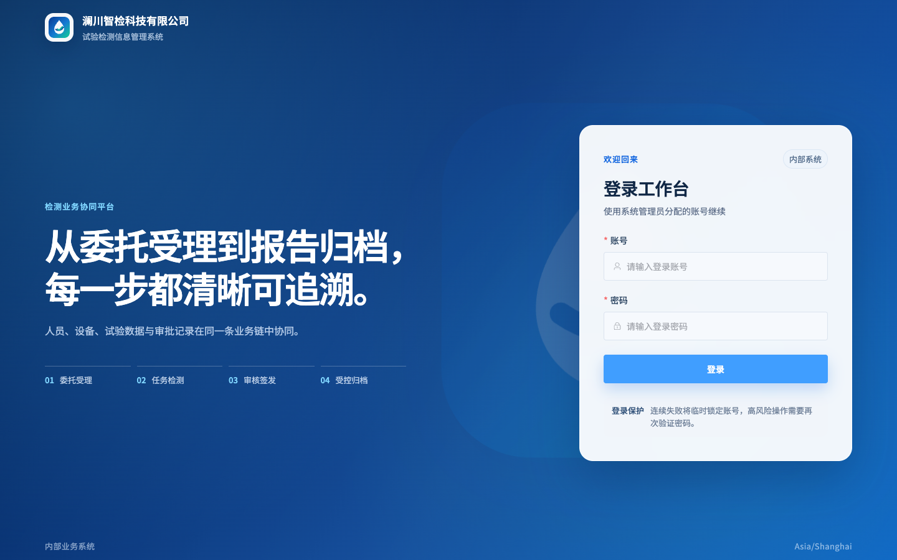<br/><b>动态登录与安全会话</b></td>
    <td width="50%">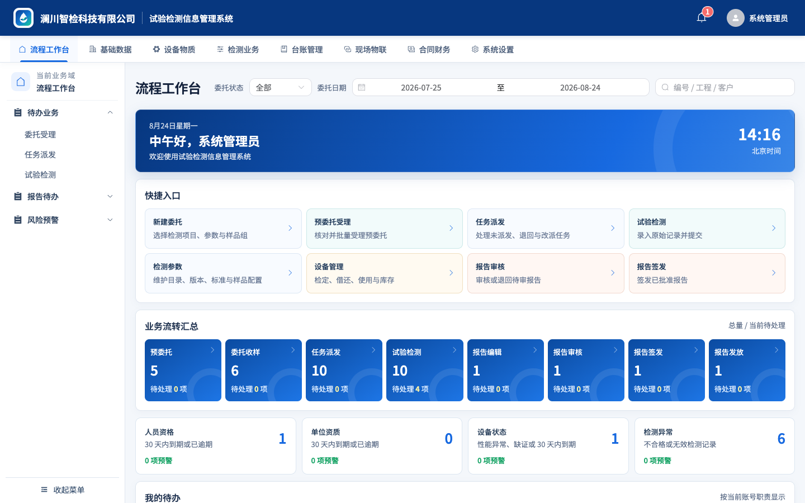<br/><b>角色待办、预警与业务阶段工作台</b></td>
  </tr>
  <tr>
    <td>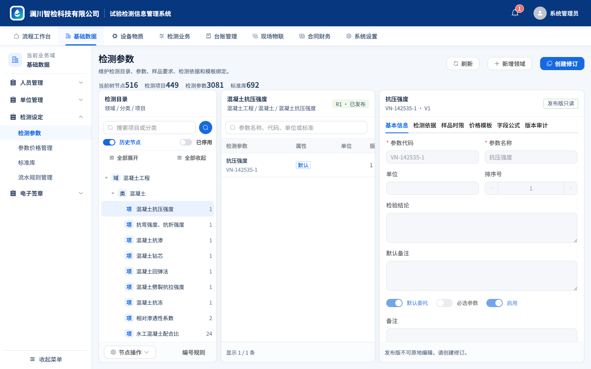<br/><b>树状检测目录、参数与受控版本</b></td>
    <td>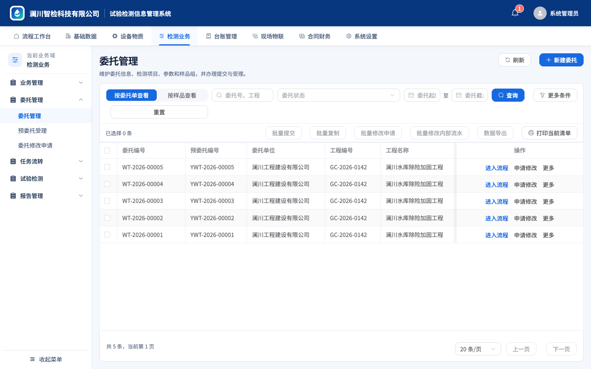<br/><b>委托查询、受理与参数选择</b></td>
  </tr>
  <tr>
    <td>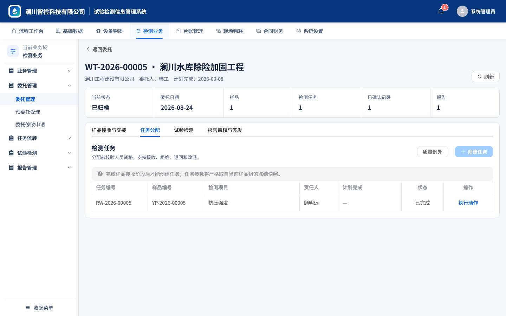<br/><b>样品接收、交接与冻结任务</b></td>
    <td>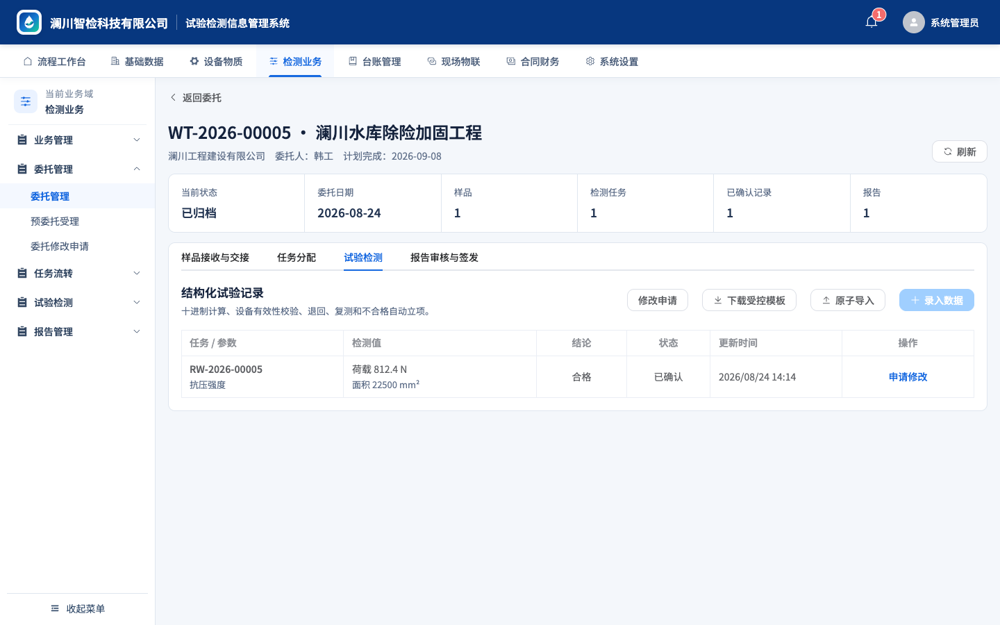<br/><b>结构化原始记录、设备与独立复核</b></td>
  </tr>
  <tr>
    <td>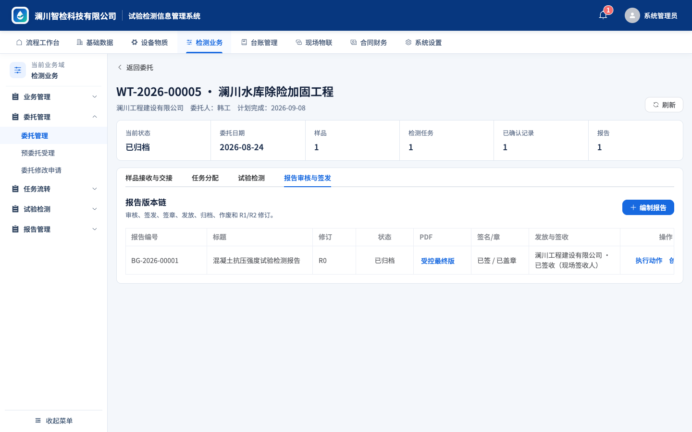<br/><b>审核、签发、签章、发放与归档</b></td>
    <td>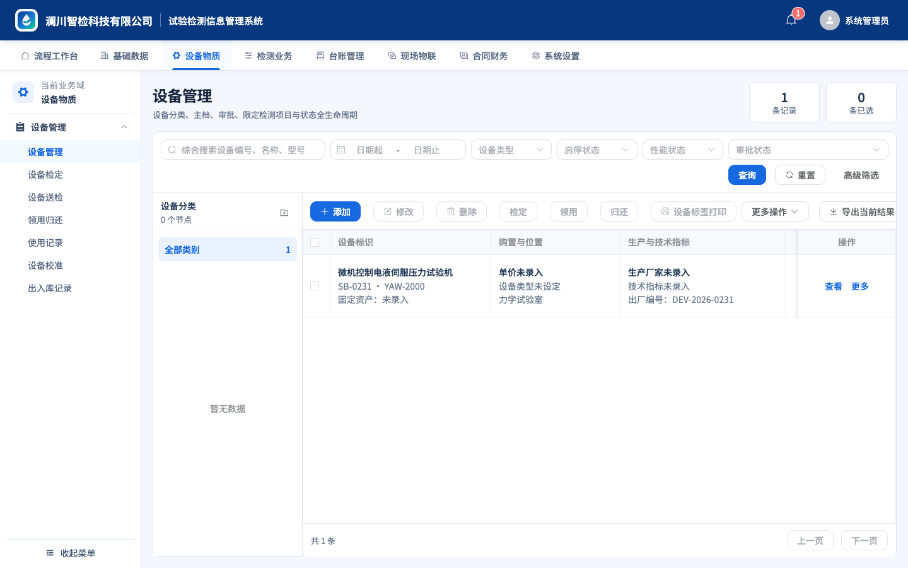<br/><b>设备、检定、送检、借还、校准与库存</b></td>
  </tr>
  <tr>
    <td>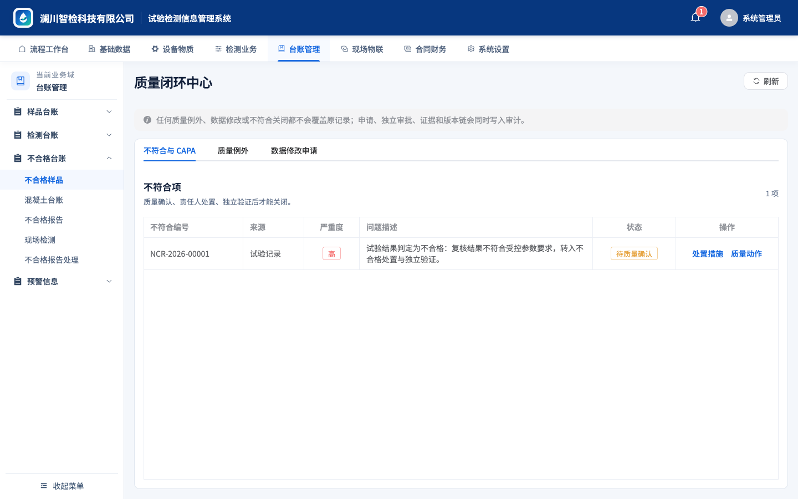<br/><b>不合格、CAPA 与独立验证</b></td>
    <td>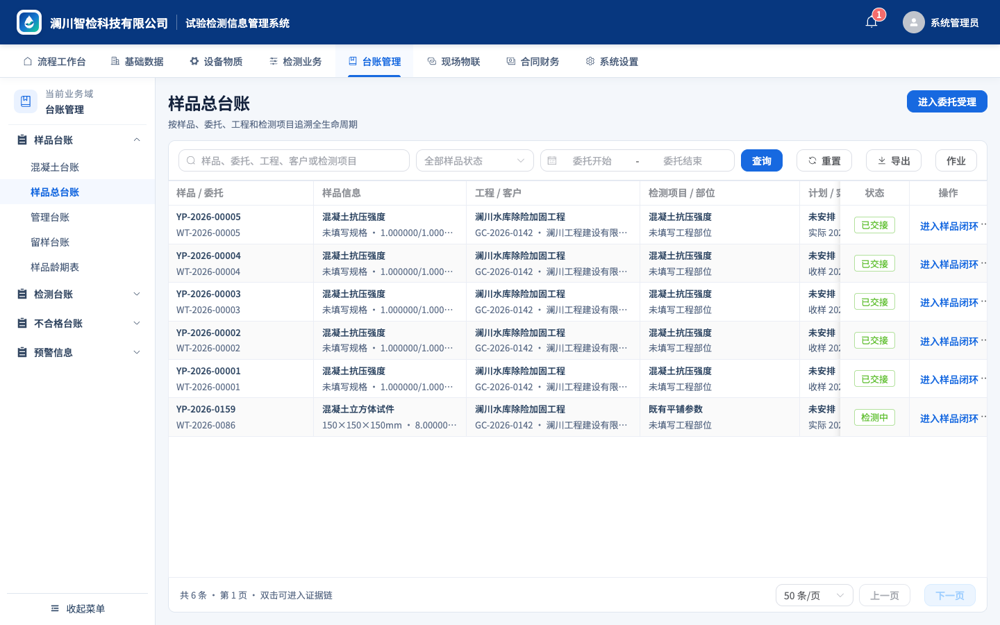<br/><b>样品、试验、报告与质量台账</b></td>
  </tr>
  <tr>
    <td>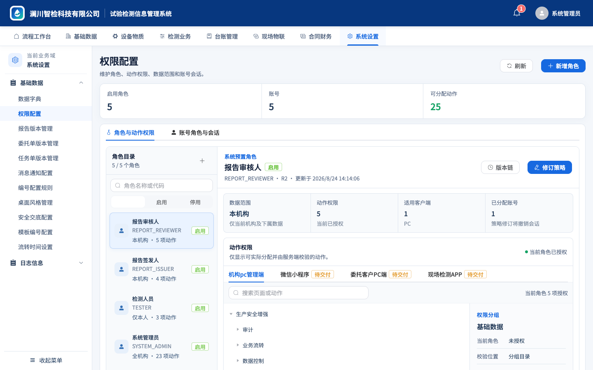<br/><b>角色、动作权限、数据范围与会话</b></td>
    <td>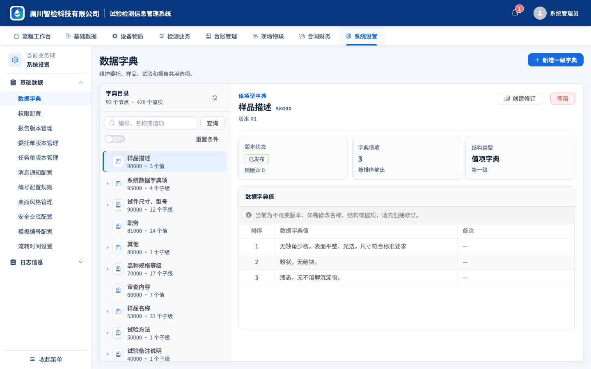<br/><b>字典、编号、模板版本与通知规则</b></td>
  </tr>
</table>

所有截图均由本仓库代码在独立 PostgreSQL 演示库中真实运行后生成，没有从内部环境打码复用。完整说明见 [展示数据说明](docs/showcase-data.md)。

## 业务闭环

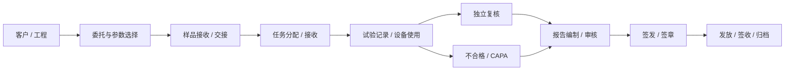

- 委托受理时冻结检测项目、参数版本、样品配置和模板控制信息，后续配置修订不会改写历史业务。
- 任务只能来自委托已冻结参数；人员资格、部门检测范围和设备有效期由后端强制校验。
- 原始记录使用受控字段与 `BigDecimal` 公式；退回、复测和数据修改申请保留版本链与审计。
- 报告主编号稳定，修订使用 `R1/R2`；签发后的 PDF、签名、机构章、发放与归档记录不可原地覆盖。
- 不合格关闭前必须完成责任人处置和独立验证；受影响报告在质量闭环完成前受到阻断。

## 功能地图

| 业务域 | 主要能力 |
| --- | --- |
| 流程工作台 | 快捷入口、阶段统计、角色待办、资格/设备/检测预警、通知、动态与重点委托 |
| 基础数据 | 人员、资格、培训、职称、单位、部门、项目组、机构/计量资质、货架、检测目录、参数、标准与价格 |
| 设备物质 | 设备主档、检定证书、送检、借还、使用、校准、出入库与到期预警 |
| 检测业务 | 工程、客户、预委托、委托、样品、任务、试验、复核、数据修改与退回改派 |
| 报告管理 | 编制、审核、签发、人员签名、机构章、发放、签收、打印、归档、修订与作废 |
| 台账质量 | 样品/试验/报告台账、不合格、CAPA、质量例外、评定汇总与预警 |
| 合同财务 | 合同、价格模板、费用、收款、退款和付款审批的软件流程 |
| 系统治理 | 角色权限、数据范围、字典、编号、通知、受控文档版本、操作日志与外部集成就绪状态 |

更细的页面、动作和状态说明见 [功能清单](docs/features.md)。

## 技术实现

- 后端：Java 21、Spring Boot 4.1、Spring Security、Spring Session JDBC、Flyway、Maven Wrapper。
- 前端：Vue 3、TypeScript、Vite 8、Element Plus、Pinia、Vue Router、Playwright。
- 数据：PostgreSQL 18、稳定游标分页、乐观锁、幂等键、前向迁移、不可变版本链。
- 文件与报告：SHA-256 内容寻址、受控上传、隔离 Chromium PDF 渲染、加密签章素材。
- 运维：Docker Compose、Nginx、Prometheus、Grafana、结构化日志、健康检查、JFR、备份恢复脚本。

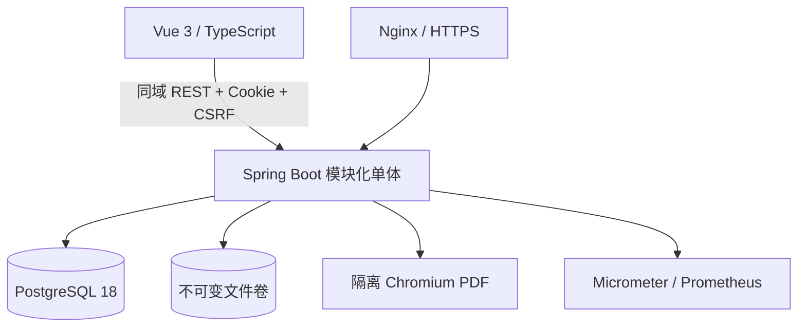

领域边界和数据所有权详见 [架构说明](docs/architecture.md)。

## 本地运行

需要 Docker 与 Docker Compose。先复制环境文件，并将所有 `replace-with-*` 值替换为本机随机值；仓库不提供默认密码。

```bash
cp deploy/.env.example deploy/.env
# 编辑 deploy/.env；32 字节密钥可用 `openssl rand -base64 32` 生成
docker compose --env-file deploy/.env -f deploy/compose.yml up -d --build
```

打开 `http://127.0.0.1:8080`。首次使用 `BOOTSTRAP_ADMIN_SECRET` 登录后必须修改管理员密码；`DEV_SEED_PASSWORD` 仅用于本地虚构角色账号 `tester`、`reviewer`、`issuer` 和 `quality`。不要把演示环境或这些账号暴露到公网。

停止并清理演示数据：

```bash
docker compose --env-file deploy/.env -f deploy/compose.yml down -v
```

## 开发与验证

```bash
npm --prefix frontend ci --no-audit --no-fund
npm --prefix frontend run check
npm --prefix frontend run test
npm --prefix frontend run build
./mvnw verify
docker compose --env-file deploy/.env -f deploy/compose.yml config
```

测试覆盖状态机、权限、幂等、乐观锁、版本不可变、编号、公式、文件、PostgreSQL 迁移和主要浏览器流程。公开仓 CI 会执行源码脱敏门禁、前端类型/单元/构建和 Java/PostgreSQL 测试。

## 安全与边界

- 会话使用 HttpOnly/SameSite Cookie，生产 HTTPS 模式要求 Secure Cookie；启用 CSRF、CSP、登录限流、锁定和会话撤销。
- 状态变更由后端同时校验动作权限、数据范围、业务前置、`expectedVersion` 与 `Idempotency-Key`。
- 上传校验扩展名、MIME、文件头、结构、大小和内容安全；签章素材加密保存，高风险动作要求近期密码复核。
- 已发布配置、已提交检测数据和已签发报告通过新版本修订，不允许普通管理员物理删除历史链或审计事件。
- 物联、支付、监管平台、短信邮件和法律 CA 在缺少真实协议/证书/沙箱时保持明确禁用，不用模拟成功冒充接入。

本仓库版本仍为 `0.1.0-SNAPSHOT`，代表可运行的技术展示，不代表完成特定机构的法规签字、生产恢复演练或外部系统验收。

## 许可

本仓库原创应用代码采用 [MIT License](LICENSE)，允许按照许可证条款使用、修改、分发及商用。使用软件的副本或实质性部分时，须保留版权声明及许可证声明。第三方组件、依赖及另有声明的材料仍遵循各自的许可证；本许可不替代第三方数据或材料所需的授权。
